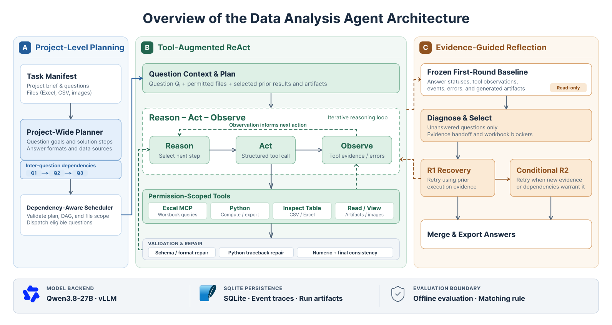

# modeloff-data-analysis-agent

An agent for solving project-based data analysis tasks in ModelOff, sourced from the data analysis subset of DSBench. It plans across related questions, uses tools to inspect and compute from the supplied files, and revisits unanswered questions in a separate Reflection stage.

## Dataset

[ModelOff](https://fmworldcup.com/modeloff-the-championship-that-came-before-fmwc/) was a global financial modeling competition with Excel-based cases and largely independent data questions; the tasks can also be solved with tools such as Python or MATLAB. This project uses the [data analysis subset](https://github.com/LiqiangJing/DSBench/blob/main/data_analysis/readme.md) of [DSBench](https://github.com/LiqiangJing/DSBench), whose tasks include ModelOff cases. This dataset contains **35 projects and 403 questions**.

| Metric | Mean | Max | Min | Total |
|---|---:|---:|---:|---:|
| Questions per project | 11.51 | 50 | 3 | 403 |
| Introduction length (words) | 506.03 | 1,169 | 0 | 17,711 |
| Question length (words) | 36.90 | 144 | 6 | 14,872 |
| Excel files | 0.77 | 2 | 0 | 27 |
| Excel file size (KiB) | 202.49 | 2,755.92 | 0.00 | 7,087.26 |
| Standalone images | 0.14 | 1 | 0 | 5 |
| Worksheets | 2.09 | 13 | 0 | 73 |

## Method

Our framework combines **project-level planning, tool-augmented ReAct, and evidence-guided Reflection** to solve multi-question data-analysis tasks. The experiments use a locally served, image-capable [Qwen3.8-27B-AWQ-4bit](https://huggingface.co/barrydeen/Qwen3.8-27B-AWQ-4bit) model (27B parameters, 4-bit weights).



### A. Project-Level Planning

A file-based task manifest organizes project context, questions, and authorized attachments. The planner generates question-level plans and dependencies, while a dependency-aware scheduler validates execution order and controls access to prior results.

### B. Tool-Augmented ReAct

Each question follows a **Reason–Act–Observe** loop using Excel MCP, Python, table inspection, and artifact/image tools. Tool feedback drives subsequent actions, supported by bounded format repair, Python error correction, and numerical answer validation.

### C. Evidence-Guided Reflection

Reflection revisits **unanswered questions only**, using frozen first-round traces, errors, and artifacts. R1 performs evidence-guided recovery; R2 runs conditionally when new execution evidence or actionable workbook dependencies justify another attempt. Previously answered questions remain unchanged.

**Runtime & Evaluation.** Qwen3.8-27B is served locally via vLLM. SQLite records execution states and events, while artifacts are stored per run. Gold answers and scoring rules are isolated from the agent and used only for offline evaluation.

## Results

The following runs are evaluated on the same 403-question active subset with a **provisional, rule-based offline scorer**:

| Architecture | Answered | Correct | Incorrect | Unanswered | Accuracy (all) | Accuracy (answered) |
|---|---:|---:|---:|---:|---:|---:|
| [Project planning and ReAct](results/public/Project_planning_and_ReAct_answers.jsonl) | 280 | 226 | 54 | 123 | 56.08% | 80.71% |
| [Project planning, ReAct and Reflection](results/public/Project_planning_and_ReAct_and_Reflection_answers.jsonl) | 315 | 245 | 70 | 88 | 60.79% | 77.78% |

Among answered questions, Project planning + ReAct achieved **80.71% accuracy**. It answered **280/403** questions, with **226 correct (56.08% of all questions)**. Adding Reflection increased this to **315 answered and 245 correct (60.79% of all questions)**, a gain of **19 correct answers and 4.71 percentage points**.

The [DSBench paper](https://arxiv.org/abs/2409.07703) reported **34.12%** task-level data-analysis accuracy for AutoGen with GPT-4o. [OpenAI's DSBench data-analysis chart](https://openai.com/index/introducing-chatgpt-agent/) reports pass@1 accuracy of **34.1%** for GPT-4o, **64.1%** for humans, **87.9%** for o3, and **89.9%** for ChatGPT agent.

## Setup and run

1. **Create the environment.**

   ```bash
   # Use Python 3.11 for this environment.
   python -m venv .venv
   .venv/bin/python -m pip install -r requirements.txt
   ```

2. **Download the model.**

   ```bash
   # Download the model, tokenizer, and image processor.
   .venv/bin/hf download barrydeen/Qwen3.8-27B-AWQ-4bit \
     --local-dir models/Qwen3.8-27B-AWQ-4bit
   ```

3. **Start vLLM.**

   ```bash
   # Run this server in the first terminal.
   export AGENT_MODEL_PATH="$PWD/models/Qwen3.8-27B-AWQ-4bit"
   .venv/bin/vllm serve "$AGENT_MODEL_PATH" \
     --host 127.0.0.1 --port 8000 \
     --served-model-name qwen38-int4 \
     --quantization compressed-tensors --dtype bfloat16 \
     --max-model-len 12000 --max-num-seqs 1 \
     --limit-mm-per-prompt '{"image": 13, "video": 0}' \
     --mm-processor-kwargs '{"max_pixels": 1048576}' \
     --reasoning-parser qwen3
   ```

4. **Run Project planning + ReAct.**

   ```bash
   # Run the first stage in a second terminal.
   export PYTHONPATH="$PWD/src"
   export AGENT_MODEL_PATH="$PWD/models/Qwen3.8-27B-AWQ-4bit"
   export AGENT_MODEL_API_BASE=http://127.0.0.1:8000/v1
   .venv/bin/python -m data_analysis_agents.cli \
     --config configs/Project_planning_and_ReAct.yaml --workflow first_round --run-id first-run
   ```

5. **Run Reflection.**

   ```bash
   # Reuse the first stage's output while vLLM is still running.
   .venv/bin/python -m data_analysis_agents.cli \
     --config configs/reflection.yaml --workflow reflection \
     --baseline-run-dir runs/first-round/first-run --run-id reflection-run
   ```

## Repository layout

```text
modeloff-data-analysis-agent/
├── assets/                  # Architecture overview image
├── configs/                 # First-round and Reflection settings
├── data/
│   ├── raw_data/            # Questions, introductions, and attachments
│   ├── preprocessed/        # Task manifest and evaluation references
│   └── answer/              # Source answer metadata
├── src/
│   └── data_analysis_agents/ # Agent workflow, model, tools, and runtime
├── preprocess/              # Manifest and evaluation-input preparation
├── evaluation/              # Offline scoring and reports
├── data_analysis/           # Input inventory and statistics
├── results/
│   └── public/              # Per-question answers and metrics
├── models/
│   └── .gitkeep             # Download model weights separately
├── requirements.txt         # Python dependencies
└── LICENSE                  # MIT license
```


